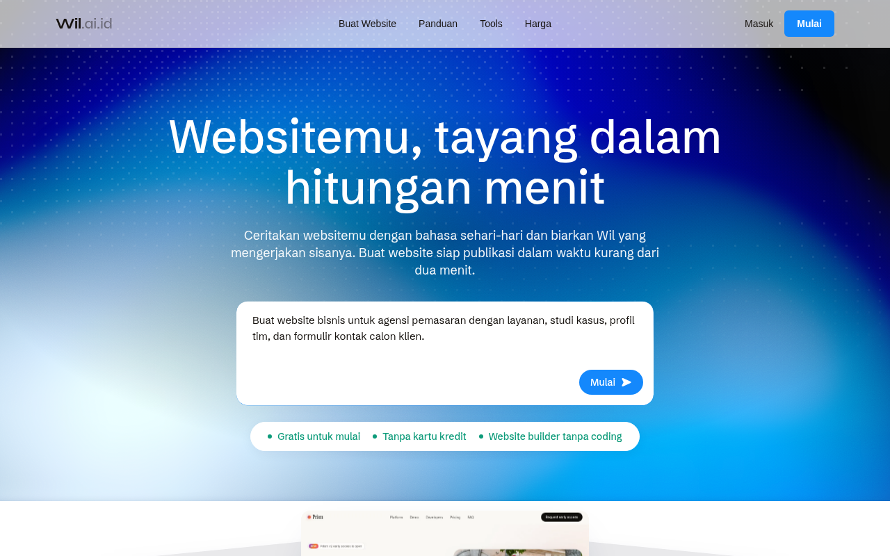

  

  

  Medan, Indonesia · Computer Science at BINUS University 
  <a href="https://wil.ai.id"><strong>wil.ai.id</strong></a> · <a href="mailto:wilverses@gmail.com">wilverses@gmail.com</a>

## Featured project: Wil.ai

**An AI website builder for Indonesia.** Describe a site in everyday Indonesian and Wil generates a preview and helps you publish in under two minutes.

  

| | How it works |
| :--- | :--- |
| **Application** | Next.js, TypeScript, tRPC, Drizzle ORM, PostgreSQL, and Better Auth |
| **AI & runtime** | OpenAI, Anthropic, and Gemini via the Vercel AI SDK, with code execution in Daytona sandboxes |
| **Operations** | Deployed on Railway, with KiPay checkout for subscriptions and acquisition through Google Ads and SEO |

## Selected projects

<table>
  <tr>
    <td width="50%" valign="top">
      <h3>Evo</h3>
      
A mobile app for iOS and Android.

      React Native · Expo · Capacitor
    </td>
    <td width="50%" valign="top">
      <h3>E-Class</h3>
      
An AI-assisted learning platform with an in-browser code editor.

      Next.js · Hono · Trigger.dev · Sentry
    </td>
  </tr>
  <tr>
    <td width="50%" valign="top">
      <h3>UpdatePTN</h3>
      
A content platform with rich-text editing and AI features.

      Next.js · PostgreSQL · Tiptap · Gemini
    </td>
    <td width="50%" valign="top">
      <h3>Rakit</h3>
      
The first version of my AI website builder.

      Next.js · MCP · Monaco
    </td>
  </tr>
</table>

Most of my work lives in private repositories. I'm happy to walk through the code on request.

## Tech stack

**Web and data** 

**Shipping and collaboration** 

I also work with React Native and Expo for mobile, tRPC for APIs, and Railway for deployments.

## GitHub activity

  
  

